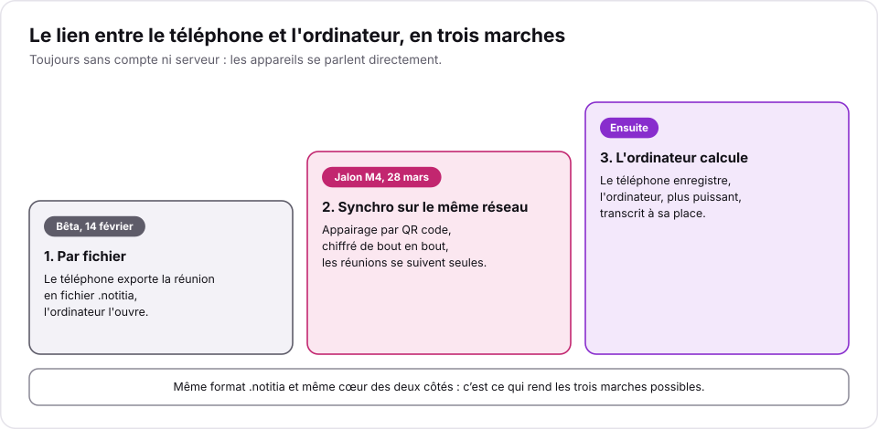

# 7. Le lien entre appareils

Le téléphone et l'ordinateur d'une même personne se relient directement, sans compte et sans serveur. On y arrive en trois marches, de la plus simple à la plus ambitieuse.

## Pourquoi c'est le cœur qui rend le lien possible

Un concurrent qui calcule dans le cloud synchronise par son serveur. Nous n'en avons pas. Deux appareils ne peuvent donc se comprendre que s'ils parlent exactement la même langue.

| Ce qu'il faut | Ce qui le garantit |
| --- | --- |
| Le même fichier de réunion des deux côtés | Le format `.notitia`, versionné, écrit et lu par le cœur |
| La même façon de fusionner deux versions d'une réunion | Le même code de fusion, dans le cœur |
| Le même chiffrement | Le même code, dans le cœur |

Avec deux cœurs différents, chacune de ces lignes devrait être écrite deux fois et pourrait diverger. Avec un seul, elles sont justes par construction.

## Les trois marches

| Marche | Quand | Ce que fait l'utilisateur | Ce qu'il faut construire |
| --- | --- | --- | --- |
| 1. Par fichier | Bêta, 14 février | Il envoie une réunion à son ordinateur comme un fichier | L'export et l'import du format `.notitia` |
| 2. Synchro sur le même réseau | Jalon M4, 28 mars | Il scanne un QR code une fois, puis les réunions se suivent seules | L'appairage, le chiffrement de bout en bout, la découverte sur le réseau |
| 3. L'ordinateur calcule | Ensuite | Il enregistre sur son téléphone, l'ordinateur transcrit à sa place | L'envoi de l'audio à un appareil relié, et le retour du résultat |

La troisième marche répond à une vraie limite : un téléphone moyen transcrit lentement. Un ordinateur relié, plus puissant, peut le faire pour lui. Rien ne sort pour autant, puisque les deux appareils appartiennent à la même personne.

## Ce qu'on a regardé

[Anytype](https://doc.anytype.io/anytype/data/sync-and-backup/local-only.md) propose un mode sans serveur où les appareils se synchronisent sur le même réseau. Ce mode est encore expérimental chez eux, ce qui dit bien que la marche 2 n'est pas un détail.

## Les règles du lien

Elles viennent du cadre du projet et ne se discutent pas ici.

- Relier ses propres appareils est permis, chiffré de bout en bout, sans compte ni serveur.
- Une réunion, un appareil qui enregistre.
- Pas de relais sur un serveur à nous. Seulement si la bêta en montre le besoin, et par une décision à part.

## Ce qui reste à décider

Le protocole de la marche 2 (comment deux appareils se trouvent, s'authentifient et fusionnent) fera l'objet de sa propre fiche de décision avant d'être codé.
