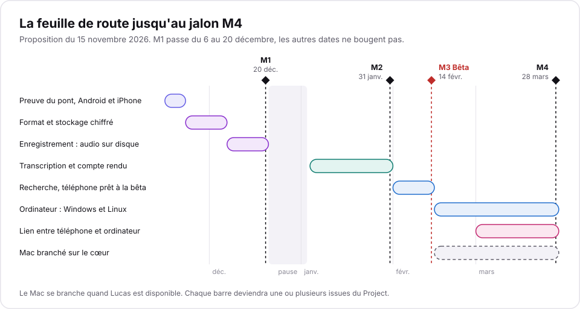

# 8. La feuille de route

On prouve le pont avant de réécrire quoi que ce soit, puis on porte le cœur morceau par morceau. Le jalon M1 passe du 6 au 20 décembre, la bêta du 14 février ne bouge pas.

## Les étapes

| # | Étape | Fini quand | Pour |
| --- | --- | --- | --- |
| 1 | La preuve du pont | Un mini cœur Rust lit un fichier `.notitia`, appelé depuis l'app Android et depuis l'app iPhone | 22 novembre |
| 2 | Le format et le stockage chiffré | Le cœur Rust passe les tests du cœur Kotlin actuel, qui servent de cahier des charges | 6 décembre |
| 3 | L'enregistrement | L'audio est découpé, compressé et écrit sur le disque au fil de l'eau. **Jalon M1** | 20 décembre |
| 4 | La transcription et le compte rendu | Sur l'appareil, derrière une interface. **Jalon M2** | 31 janvier |
| 5 | La recherche et le téléphone branché | Les écrans tournent sur le cœur. **Jalon M3, la bêta** | 14 février |
| 6 | L'ordinateur, Windows et Linux ensemble | Une visio enregistrée sans bot | 28 mars |
| 7 | Le lien | Le téléphone relié à l'ordinateur sur le même réseau. **Jalon M4** | 28 mars |
| 8 | Le Mac branché sur le cœur | Le Mac et le téléphone s'échangent une réunion | Quand Lucas est disponible |

L'étape 1 est un garde-fou. Si le pont vers l'iPhone ne marche pas comme prévu, on le sait en une semaine, et on revient au cœur Kotlin sans avoir rien perdu.

## Ce qui change dans le calendrier

| Jalon | Avant | Maintenant | Ce qui change |
| --- | --- | --- | --- |
| M1 Enregistrer partout | 6 décembre | 20 décembre | Deux semaines de plus, pour porter le format et le stockage |
| M2 Compte rendu | 31 janvier | 31 janvier | La transcription y entre, elle n'est plus dans M1 |
| M3 Bêta | 14 février | 14 février | La bêta porte sur le téléphone seul |
| M4 Actions et ordinateur | 28 mars | 28 mars | Windows et Linux sortent ensemble |

La date de la bêta est fixée par l'école : le Beta Test Plan se rend le 7 février. Ces dates entrent dans le [cadre](https://github.com/NotitiaEIP/notitia_documentation/blob/main/CADRE.md) par une PR relue par toute l'équipe.

## Les risques, et ce qu'on fait

| Risque | Ce qu'on fait |
| --- | --- |
| Le pont vers l'iPhone ne marche pas comme prévu | On le prouve en premier, avant de porter le cœur |
| La bêta arrive dans trois mois avec un cœur neuf | La bêta se limite au téléphone, l'ordinateur vient après |
| Deux personnes seulement relisent le Rust | Les tests du cœur servent de filet. Clément et Alexandre relisent, d'autres se forment |
| Installer Rust et le NDK sur chaque machine | Une commande dans `./notitia`, et la CI comme référence |
| La CI devient plus longue | La compilation du cœur est mise en cache |
| Le rendu de Tauri varie sur Linux | Test sur deux distributions avant d'annoncer Linux |
| UniFFI n'est pas en version 1.0 | Versions fixées, montée dans une PR à part |
| Un moteur d'IA trop lent sur un téléphone moyen | La fiche T-06 mesure avant de choisir, et la troisième marche du [lien](07-lien.md) offre une issue |

## Qui fait quoi

| Partie | Qui |
| --- | --- |
| Le cœur Rust | Clément, relu par Alexandre |
| L'IA dans le cœur | Alexandre et Adam |
| Les écrans du téléphone | Clément et Nathan |
| Le Mac | Lucas |
| L'interface Windows et Linux | À décider au jalon M3 |
