# Identité visuelle — « Natif Apple »

## Intention

L'ancienne identité (bleu nuit, rose et cyan néon, mascotte méduse, emojis) était jugée trop enfantine.
La nouvelle est **sobre, sérieuse et discrète** : Notitia doit ressembler à une application
qu'Apple aurait pu livrer avec macOS. Le contenu de l'utilisateur est la seule chose qui attire l'œil.

## Principes

1. **Pas de couleur de marque.** L'accent est la couleur choisie par l'utilisateur dans Réglages Système.
2. **Couleurs système uniquement** (`NoteColor` → `systemBlue`, `systemRed`…). Elles s'adaptent
   automatiquement aux modes clair et sombre et au contraste renforcé.
3. **SF Pro et SF Symbols.** Aucune police ni icône tierce. Pas d'emoji dans l'interface.
4. **Composants natifs d'abord** : `NavigationSplitView`, `List(.sidebar)`, `Form(.grouped)`, `.inspector`,
   `ContentUnavailableView`, `Menu`, `ControlGroup`. Liquid Glass (`.glassEffect`, `.buttonStyle(.glass)`)
   seulement pour les éléments flottants (barre d'enregistrement, contrôles de zoom).
5. **La couleur a un sens** : dossier, tag, branche de carte mentale, surlignage choisi par l'utilisateur.
   Jamais de couleur décorative.

## Jetons (`apple/Notitia/DesignSystem/Theme.swift`)

| Jeton | Valeurs |
|---|---|
| `Spacing` | 2 · 4 · 8 · 12 · 16 · 24 · 40 |
| `Radius` | 6 (petit) · 10 (moyen) · 14 (grand) |
| `Metrics.readableWidth` | 760 pt (largeur de lecture d'une note) |
| `Metrics.indentWidth` | 24 pt par niveau d'indentation |

## Typographie de l'éditeur

| Bloc | Police |
|---|---|
| Titre de la note | SF Pro 34 Bold |
| Titre 1 / 2 / 3 | SF Pro 28 Bold / 22 Semibold / 18 Semibold |
| Texte, listes, citations | SF Pro 15, interligne 5 pt |
| Code | SF Mono 13 |

## Icône

Carré arrondi au gabarit macOS, fond papier légèrement ligné, « N » en serif New York graphite,
et une courte onde sonore bleu système : la prise de notes et la transcription.
Générée par script (CoreGraphics) dans `Resources/Assets.xcassets/AppIcon.appiconset`. Une version
Icon Composer (Liquid Glass, variantes sombre et teintée) reste à faire.

## Captures

Générées automatiquement (`-NotitiaDemoMode YES -NotitiaSnapshots YES`). La barre latérale et l'inspecteur
utilisent des matériaux translucides que cette méthode ne sait pas capturer : ils apparaissent vides sur les
images, mais s'affichent normalement dans l'application.

| | |
|---|---|
|  | 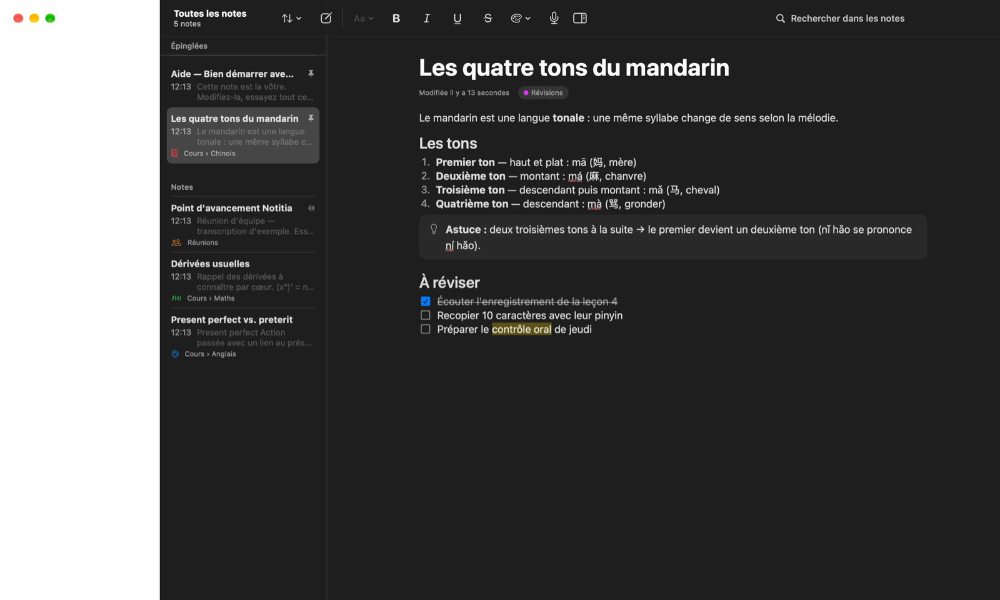 |
|  | 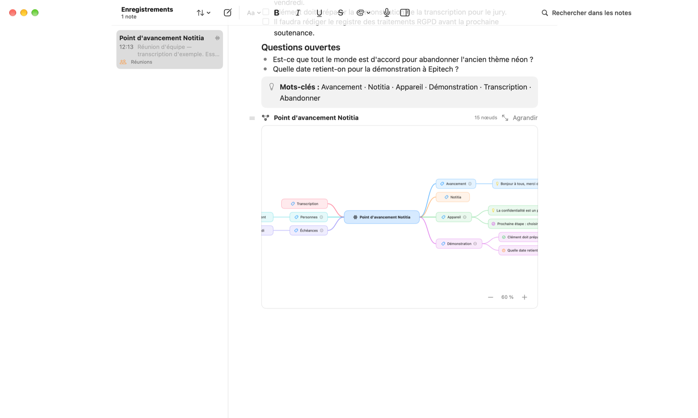 |
| 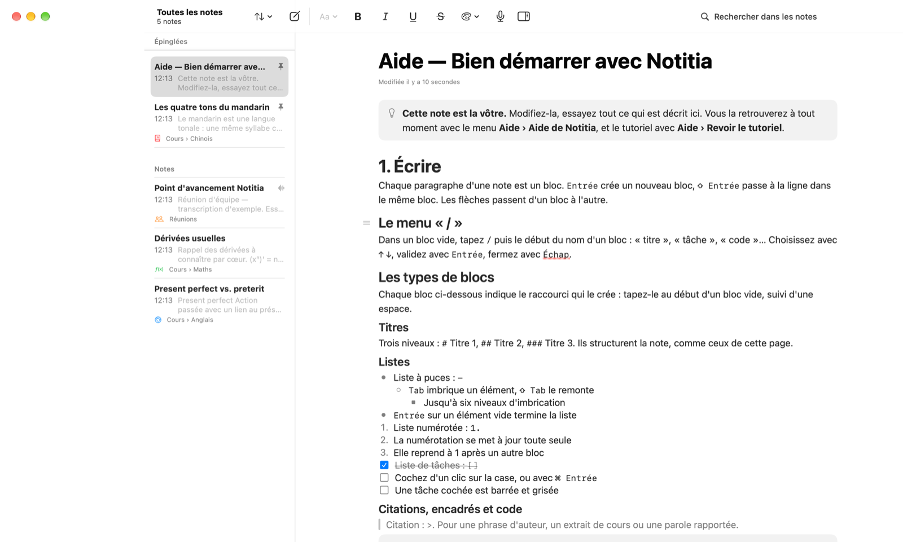 | 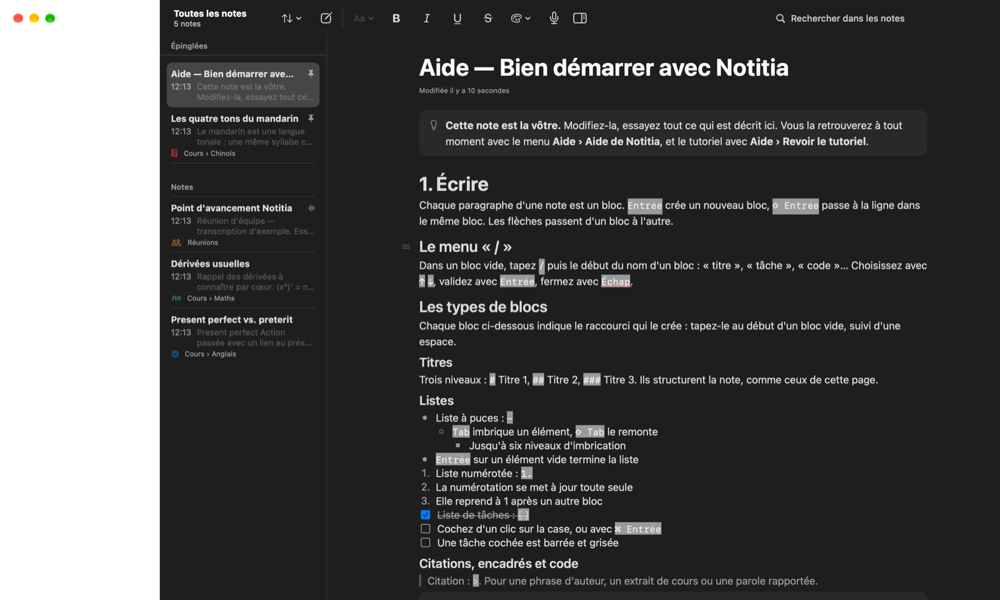 |
| 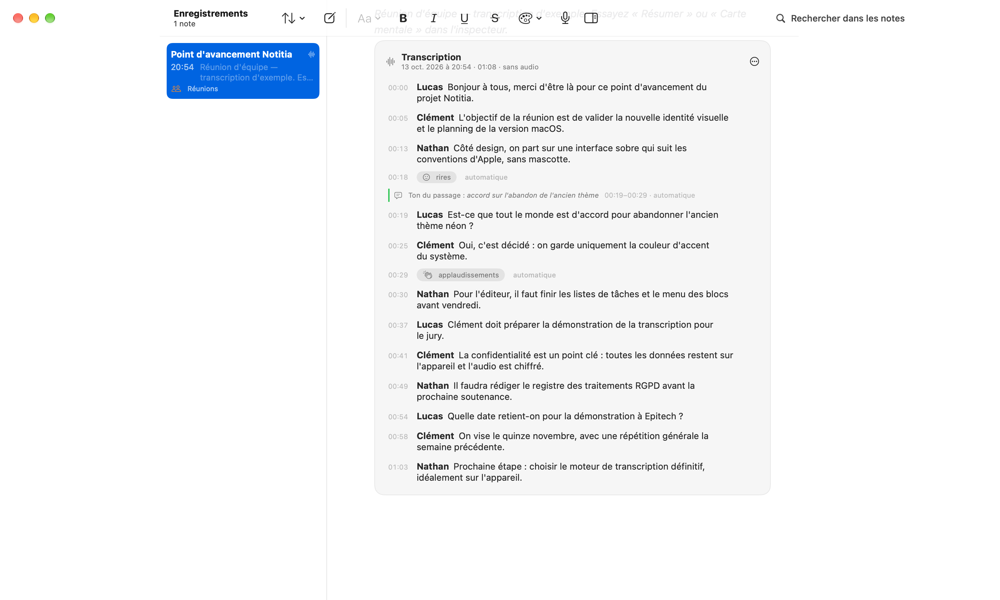 | 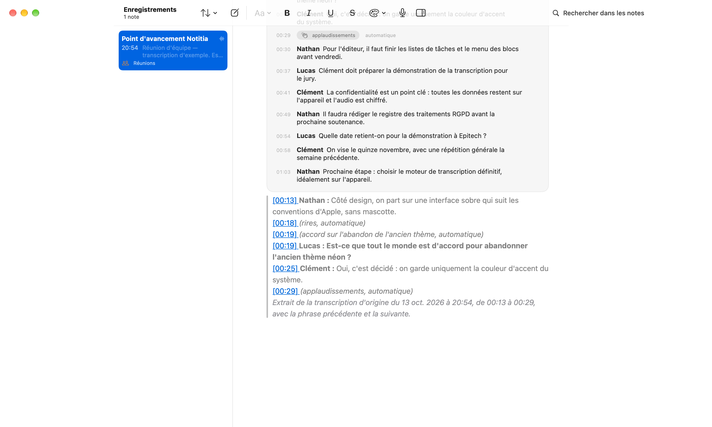 |

Transcription enrichie : les annotations sont des puces grises discrètes (SF Symbols, sans emoji), toujours suivies
de « automatique ». Le ton d'un passage est un bandeau dont le filet a un sens : vert pour un passage positif,
orange pour un passage tendu, gris sinon.

### Tutoriel du premier lancement

Sept pages : bienvenue, organiser, écrire, enregistrer, intelligence, confidentialité, choix de départ.
Chaque illustration reproduit l'interface réelle en version simplifiée. Navigation au clavier (← →, Entrée).
Les captures sont rendues hors écran (`ImageRenderer`) : les boutons AppKit, comme « Passer le tutoriel »,
y apparaissent comme des rectangles jaunes, mais s'affichent normalement dans l'application.

| | |
|---|---|
| 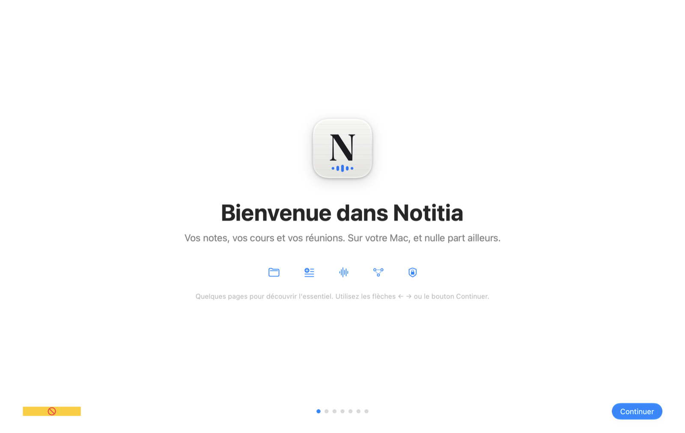 | 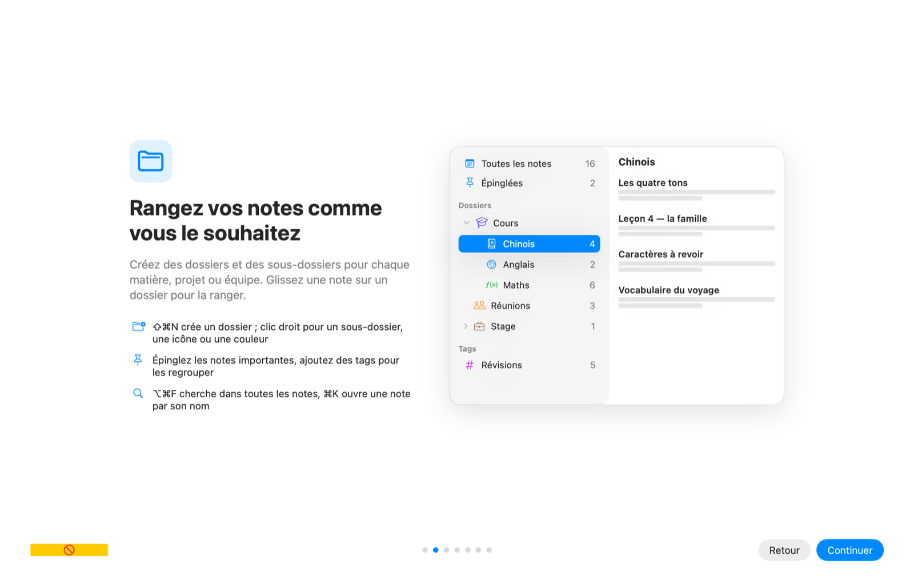 |
| 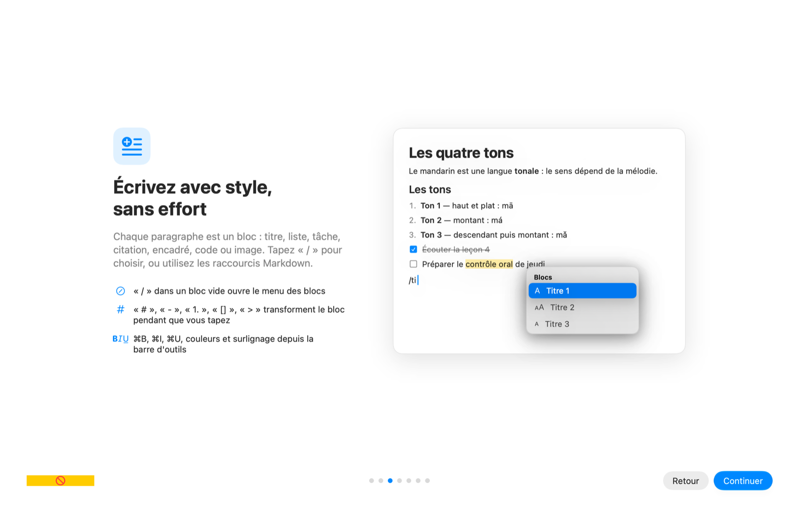 | 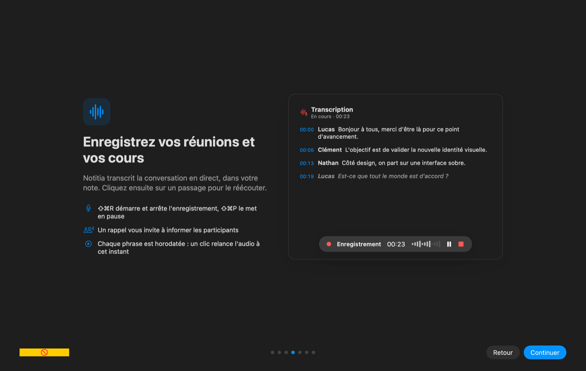 |
| 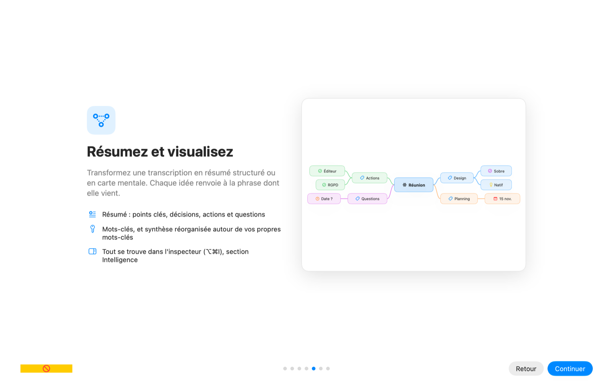 | 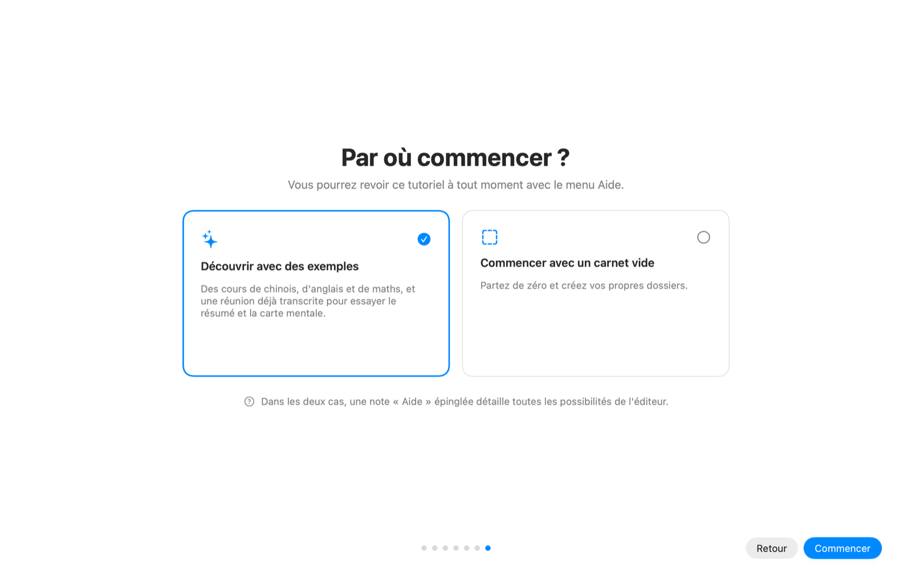 |
