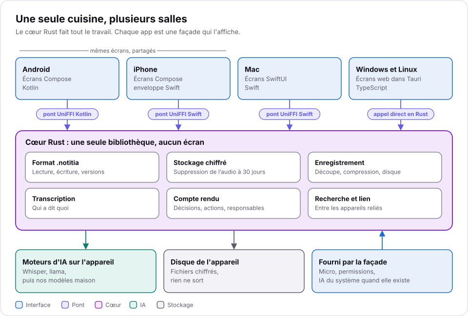

# Documentation technique de Notitia

Ce dossier explique pourquoi Notitia est construit comme il l'est : quelle technologie pour quel appareil, sur quels exemples on s'est appuyés, et ce que chaque choix nous coûte.

Il se lit en dix minutes. Chaque page commence par sa conclusion, puis la montre par un schéma.

## Par où commencer

| Page | La question à laquelle elle répond |
| --- | --- |
| [1. Vue d'ensemble](01-vision.md) | À quoi ressemble Notitia une fois fini, et quelles règles dessinent l'architecture |
| [2. Le benchmark](02-benchmark.md) | Comment font les leaders et nos concurrents, sources à l'appui |
| [3. Le cœur commun en Rust](03-coeur-rust.md) | Pourquoi un seul cœur, pourquoi Rust, et ce qu'on y perd |
| [4. Android et iPhone](04-android-iphone.md) | Pourquoi Kotlin et Compose pour les écrans du téléphone |
| [5. Mac](05-mac.md) | Pourquoi le Mac reste en Swift, et ce qui change pour lui |
| [6. Windows et Linux](06-windows-linux.md) | Pourquoi une seule interface, dans Tauri, et comment capter une visio |
| [7. Le lien entre appareils](07-lien.md) | Comment le téléphone et l'ordinateur se parlent sans serveur |
| [8. La feuille de route](08-feuille-de-route.md) | Dans quel ordre on construit, et les risques qu'on surveille |
| [9. Les sources](09-sources.md) | Tous les liens du benchmark, avec la date de vérification |

Les décisions elles-mêmes sont dans les fiches du dossier [`adr/`](adr/). Une fiche se lit en deux minutes et ne change plus : pour revenir sur un choix, on écrit une nouvelle fiche qui remplace l'ancienne.

| Fiche | Décision | Statut |
| --- | --- | --- |
| [0002](adr/0002-coeur-rust.md) | Un cœur Rust pour toutes les apps, une interface par famille d'appareils | Acceptée le 15 novembre 2026 |

## Le code couleur des schémas

Les mêmes couleurs veulent dire la même chose sur toutes les pages.

| Couleur | Ce qu'elle désigne |
| --- | --- |
| Bleu | Une interface : ce que l'utilisateur voit |
| Violet | Le cœur Rust : ce qui fait le travail |
| Indigo | Un pont entre une interface et le cœur |
| Vert | Du code propre à un système (Android, iPhone, Mac) |
| Turquoise | L'IA qui tourne sur l'appareil |
| Gris | Le stockage, ou un élément neutre |
| Orange et rouge | Un point d'attention, une option écartée, un serveur |

## Tenir ce dossier à jour

- Un choix technique qui change passe par une nouvelle fiche dans `adr/`, puis par la page concernée.
- Les schémas sont des fichiers SVG dans [`schemas/`](schemas/). Ils s'ouvrent et se corrigent dans un éditeur de texte.
- Chaque fait du benchmark porte sa date. Un fait qu'on n'a pas pu vérifier est écrit comme tel.

Le cadre de l'année, lui, reste dans [CADRE.md](https://github.com/NotitiaEIP/notitia_documentation/blob/main/CADRE.md) : ce dossier explique le « comment », le cadre fixe le « quoi ».
