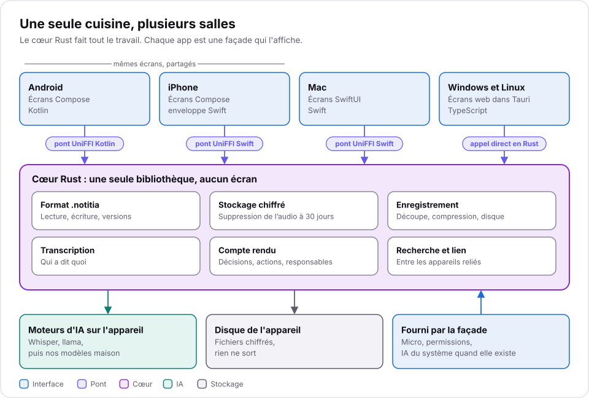

# ADR 0002 : un cœur Rust pour toutes les apps

| | |
| --- | --- |
| Statut | Acceptée le 15 novembre 2026 |
| Proposée par | Clément |
| Relue par | Alexandre pour l'IA, Lucas pour Apple |
| Tâche d'origine | T-05, élargie : elle ne visait que le client ordinateur |

## Contexte

Notitia doit tourner sur cinq systèmes et relier le téléphone à l'ordinateur sans serveur. Le code actuel contient environ 2 000 lignes de logique en Kotlin et 9 700 lignes d'écrans Compose. Le moteur reste à écrire : l'audio n'est pas gardé sur le disque et aucune IA ne tourne sur l'appareil. L'app Mac range ses données dans un format que le téléphone ne lit pas.

C'est le moment où changer de fondations coûte le moins.

## Décision

1. Toute la logique vit dans une bibliothèque Rust sans écran : format `.notitia`, stockage chiffré, enregistrement, transcription, compte rendu, recherche, lien entre appareils.
2. Chaque famille d'appareils garde sa propre interface : Compose pour Android et iPhone, SwiftUI pour le Mac, une interface web dans Tauri pour Windows et Linux.
3. Kotlin et Swift appellent le cœur par les ponts officiels d'UniFFI. Tauri l'appelle directement.
4. Windows et Linux sortent en même temps.
5. Le format `.notitia` version 1 reste lisible. Le Mac lit et écrit ce format pour les réunions.
6. Les moteurs d'IA se branchent derrière une interface du cœur. Un moteur peut vivre dans le cœur, ou être fourni par la façade quand c'est l'IA du système.
7. Clément écrit le cœur, Alexandre est le second relecteur.

## Options écartées

| Option | Pourquoi pas |
| --- | --- |
| Garder le cœur Kotlin, ordinateur en Compose Desktop | Le plus court, et valable. Écarté parce que l'audio et l'IA de l'ordinateur auraient vécu dans des programmes à part, que l'app aurait embarqué Java, et qu'on veut poser les fondations une seule fois |
| Un serveur avec des comptes | Contredit la règle « rien ne sort de l'appareil » |
| Une interface native par système sur ordinateur | Deux interfaces de plus sans personne pour les tenir |
| Electron pour l'ordinateur | Lourd, et pensé pour un cœur qui serait un site web |

Le détail de la comparaison est dans [la page 3](../03-coeur-rust.md) et [la page 6](../06-windows-linux.md).

## Conséquences

**Ce qu'on gagne.** Une modification de logique se fait une fois pour cinq systèmes. Le lien entre appareils repose sur le même code des deux côtés. L'app reste légère, et la mémoire va aux modèles.

**Ce qu'on paie.** Le cœur actuel est à réécrire. Le jalon M1 passe du 6 au 20 décembre. L'équipe tient trois interfaces et quatre langages. Deux personnes relisent le Rust au départ.

**Ce qui nous protège.** La preuve du pont vers l'iPhone passe avant tout le reste : si elle échoue, on revient au cœur Kotlin en ayant perdu une semaine. Les tests du cœur actuel servent de cahier des charges au nouveau.

## Suite

- Le plan par étapes est dans [la feuille de route](../08-feuille-de-route.md).
- Restent à prouver pour la tâche T-05 : la capture d'une visio sur chaque système, la détection du début d'une réunion, le canal de distribution.
- Le protocole du lien sur le même réseau fera l'objet de sa propre fiche.
- Le cadre du projet est à mettre à jour : partie 6 pour l'architecture, partie 8 pour la date de M1.
