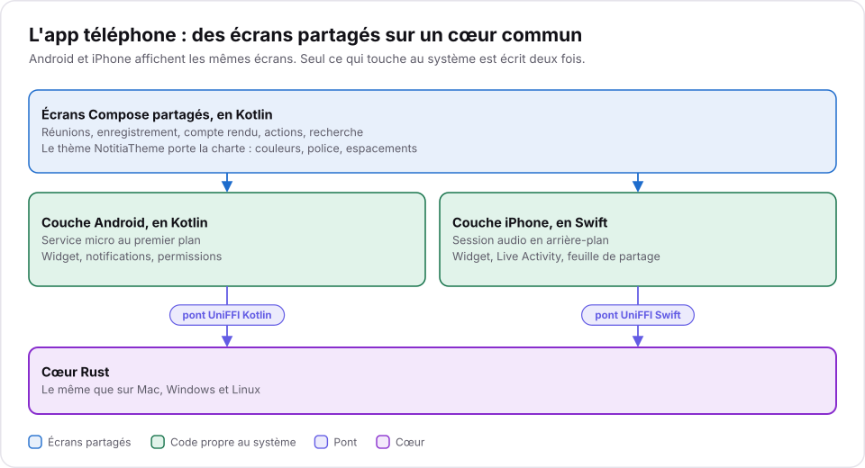

# Android et iPhone

Le téléphone garde ses écrans en Kotlin avec Compose, les mêmes sur Android et sur iPhone. Seul ce qui touche au système est écrit deux fois, et tout le travail descend dans le cœur.

## Les options comparées

| Option | Qui l'utilise | Pour | Contre |
| --- | --- | --- | --- |
| **Kotlin et Compose partagés** (retenu) | Notre code actuel | Un seul jeu d'écrans pour deux systèmes. Sur Android, c'est la technologie officielle | Sur iPhone, les écrans ne sont pas les composants d'Apple. Plus jeune sur iPhone que sur Android |
| Deux apps natives, Kotlin et Swift | [Bitwarden](https://contributing.bitwarden.com/architecture/clients/), Granola sur iPhone | Le meilleur rendu sur chaque système | Chaque écran s'écrit et se corrige deux fois |
| Flutter | Notre premier prototype, Plaud d'après ses offres d'emploi | Rapide à démarrer, un seul code | Un langage (Dart) qui ne sert qu'à ça. Le micro en arrière-plan et le widget demandent quand même du code natif |
| React Native | [Discord](https://discord.com/blog/why-discord-is-sticking-with-react-native), Fireflies | Un seul code, proche du web | Même limite que Flutter pour l'arrière-plan, et aucun de nos écrans n'existait dans cette technologie |

## Pourquoi garder Kotlin alors que le cœur passe en Rust

- **Les écrans existent.** Environ 9 700 lignes de Compose : la liste des réunions, l'enregistrement, le compte rendu, les actions, la recherche.
- **La charte y est déjà codée.** Le thème `NotitiaTheme` porte les couleurs, la police et les espacements de [DESIGN.md](../../DESIGN.md).
- **Le changement se fait dessous.** L'app reçoit déjà son stockage, son micro et ses moteurs par des interfaces. On remplace ce qu'il y a derrière ces interfaces, pas les écrans.

C'est comme changer le moteur d'une voiture en gardant le tableau de bord : le conducteur ne voit rien.

## Ce qui reste propre à chaque système

| | Android | iPhone |
| --- | --- | --- |
| Enregistrer écran verrouillé | Service de premier plan de type micro | Session audio en arrière-plan |
| Lancer d'un geste | Widget | Widget et Live Activity |
| IA du système, si elle est retenue | Gemini Nano | Apple Intelligence |
| Livrer les modèles | Play for On-device AI | Background Assets |
| Langage de cette couche | Kotlin | Swift |

## Ce qu'on accepte

- Les écrans de l'iPhone sont dessinés par Compose, pas par les composants d'Apple. Un utilisateur d'iPhone attentif peut sentir la différence sur un défilement ou un menu.
- L'iPhone a deux ponts à traverser : Swift reçoit le cœur, puis le passe aux écrans Kotlin.

## Ce qui reste ouvert

La fiche T-04 doit dire, preuve sur un vrai iPhone à l'appui, si l'iPhone garde les écrans Compose tels quels, les place dans une coque SwiftUI (onglets, navigation et feuilles du système, contenu en Compose) ou passe tout en SwiftUI comme le Mac. Le cœur Rust rend les trois réponses possibles : il se branche sur chacune.
