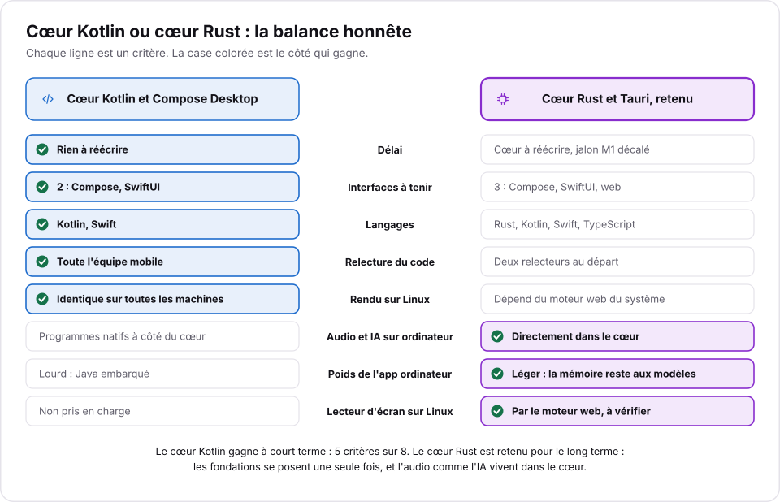
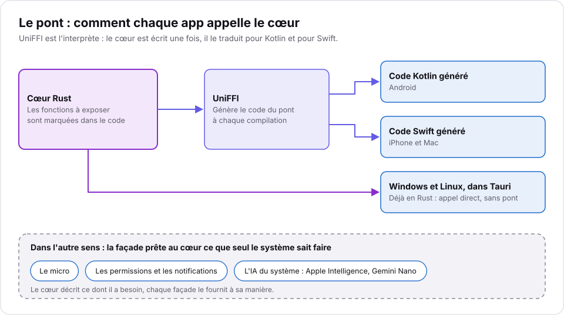
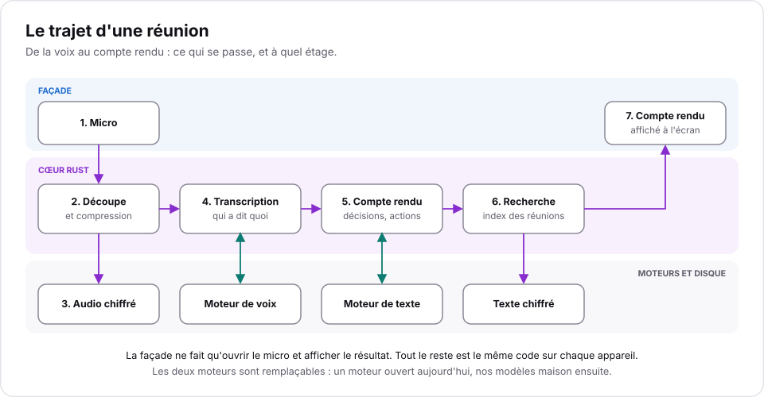

# Le cœur commun en Rust

Toute la logique de Notitia vit dans une seule bibliothèque Rust, sans aucun écran, que les cinq systèmes utilisent. On y gagne un code unique et léger. On le paie en délai et en relecture.

## Pourquoi un cœur commun

- **Une modification se fait une fois.** Corriger le format d'une réunion ou la recherche ne demande pas cinq corrections.
- **Le lien entre appareils devient simple.** Deux appareils qui exécutent le même code et lisent le même format se comprennent sans traducteur.
- **Les écrans restent libres.** Chaque interface peut changer sans risquer de casser la logique.

## Pourquoi Rust plutôt que Kotlin

Le cœur aurait pu rester en Kotlin, le langage du code actuel. C'était le chemin le plus court, et on l'a sérieusement étudié.

Le cœur Kotlin gagne sur le court terme. Le cœur Rust a été retenu parce que le moteur de Notitia reste à écrire : l'audio n'est pas encore gardé sur le disque et aucune IA ne tourne sur l'appareil. Tant qu'il n'y a qu'environ 2 000 lignes de logique à porter, changer de fondations coûte peu. Dans un an, ce serait tout rebrancher.

| Ce que Rust apporte | Ce que Rust coûte |
| --- | --- |
| Le même cœur sur les cinq systèmes, sans exception | Le cœur actuel est à réécrire, le jalon M1 est décalé |
| Une app légère : la mémoire reste aux modèles d'IA, qui pèsent plusieurs gigaoctets | Un langage de plus, plus long à apprendre que Kotlin |
| Le cœur appelle les moteurs d'IA dans le même programme | Deux relecteurs seulement au départ : Clément et Alexandre |
| Les erreurs de mémoire sont refusées à la compilation, pas découvertes chez l'utilisateur | Chaque machine doit installer Rust et le NDK Android, et la CI est plus longue |
| Le choix des produits comparables : Bitwarden, 1Password, Signal | Le pont UniFFI n'est pas encore en version 1.0 |

Une précision pour ne pas se tromper d'argument : Rust ne rend pas l'IA plus rapide. Le calcul est fait par les moteurs eux-mêmes, écrits en C++, identiques quel que soit le cœur. C'est comme changer le châssis d'une voiture : le moteur reste le même.

## Les autres langages envisagés

| Langage | Qui l'utilise | Pourquoi pas pour nous |
| --- | --- | --- |
| Kotlin | Le code actuel | Voir la balance ci-dessus : valable, mais l'ordinateur aurait demandé des programmes à part pour l'audio et l'IA |
| C++ | Spotify, Office | Aucun garde-fou contre les erreurs de mémoire, et un outillage plus lourd pour une équipe de six |
| Go | [Anytype](https://github.com/anyproto/anytype-heart) | Leur cœur tourne comme un programme séparé auquel l'app parle par gRPC : un protocole de plus à tenir |

## Le pont : comment une app appelle le cœur

Kotlin et Swift ne savent pas appeler du Rust directement. [UniFFI](https://github.com/mozilla/uniffi-rs), l'outil de Mozilla qu'utilise Bitwarden, écrit le code de liaison à notre place. Ce pont vit dans sa propre crate, `core/ffi/` : le cœur ne connaît pas UniFFI, et l'app Windows et Linux l'appelle directement, en Rust.

Trois règles pour que ce pont ne devienne pas le maillon faible :

1. **Seulement les ponts officiels**, Kotlin et Swift. Les ponts tenus par des tiers (vers Kotlin Multiplatform, vers C#) sont encore jeunes.
2. **Versions fixées.** Rust et UniFFI ne montent de version que dans une PR à part.
3. **La preuve d'abord.** Avant de porter le cœur, un mini cœur a été appelé depuis Android et depuis l'iPhone (T-55). Le résultat est dans l'[ADR 0002](../adr/0002-coeur-rust.md#résultat-de-la-preuve-du-pont-t-55).

## Le trajet d'une réunion

| Dans le cœur | Dans chaque façade |
| --- | --- |
| Le format `.notitia`, lecture et écriture | Les écrans et la navigation |
| Le stockage chiffré, l'audio supprimé à 30 jours | L'accès au micro et les permissions |
| L'enregistrement : découpe, compression, écriture au fil de l'eau | Les notifications et le widget |
| La transcription et les locuteurs | Le partage vers d'autres apps |
| Le compte rendu, les actions, la recherche | L'IA du système, quand elle existe |
| Le lien entre appareils | |

## Et l'IA dans tout ça

Le cœur ne choisit pas le moteur : il définit une interface, et un moteur s'y branche.

- Un moteur ouvert peut tourner dans le cœur lui-même, sur tous les systèmes.
- L'IA du système (Apple Intelligence sur iPhone et Mac, Gemini Nano sur Android) ne s'appelle que depuis Swift ou Kotlin. La façade la fournit alors au cœur par le pont.
- Nos modèles maison prendront la même place au jalon M5.

Le choix du moteur de la bêta n'est pas fait ici : c'est l'objet de la fiche T-06, mesures à l'appui.
