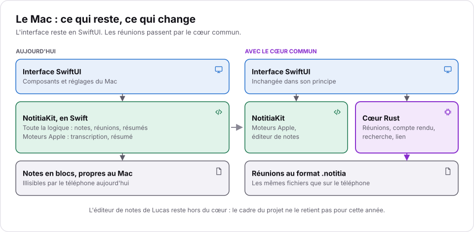

# Mac

Le Mac garde une interface native en SwiftUI, parce que l'app existe et qu'elle a un responsable. Ce qui change : ses réunions passent par le cœur commun, pour que le Mac et le téléphone lisent les mêmes fichiers.

## Pourquoi du natif ici, et pas ailleurs

Sur Windows et Linux, on partage une interface. Sur Mac, non. La différence tient en trois points.

| | Mac | Windows et Linux |
| --- | --- | --- |
| Une app existe déjà | Oui, en Swift | Non |
| Quelqu'un en est responsable | Lucas | Personne ne connaît WinUI ou GTK |
| Le système offre une IA locale | Oui, Apple Intelligence | Non |

Dessiner une interface native par système coûte cher. On ne le fait que là où le travail est déjà fait.

## Pour et contre

| Pour | Contre |
| --- | --- |
| Les composants d'Apple, donc une app qui se comporte comme le Mac | Une interface de plus à tenir, que seul Lucas connaît |
| L'accès direct à Apple Intelligence et à la capture du son du système | La charte doit y être appliquée à la main : couleur, police |
| Le pont UniFFI vers Swift est officiel | L'app doit apprendre le format `.notitia` |

## Ce qui change pour l'app de Lucas

Aujourd'hui le Mac range tout en notes à blocs, un format que le téléphone ne lit pas : les deux apps ne peuvent pas s'échanger une réunion. Avec le cœur, les moteurs d'Apple restent : la façade les fournit au cœur par le pont.

L'éditeur de notes n'entre pas dans le cœur : le [cadre](../projet/cadre.md) ne le retient pas pour cette année, les entretiens demandant un compte rendu et non un carnet de notes.

## Quand

Le Mac se branche sur le cœur une fois celui-ci validé sur le téléphone. Lucas a donné son accord sur le principe le 15 novembre 2026.
