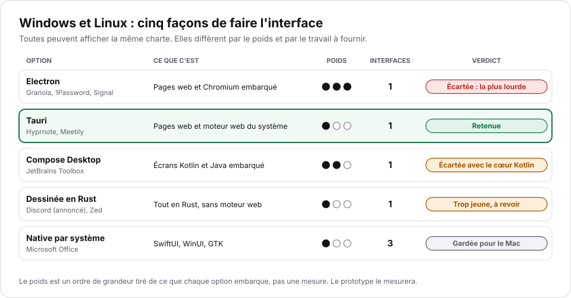
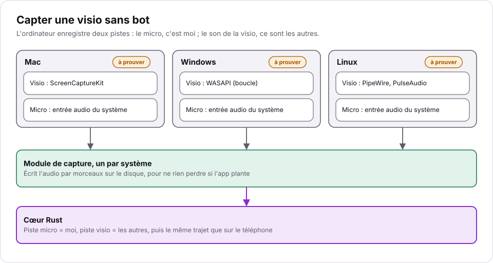

# Windows et Linux

Windows et Linux partagent une seule interface, écrite en technologies web et affichée par Tauri, posée directement sur le cœur Rust. Les deux systèmes sortent en même temps.

## Cinq façons de faire l'interface

Aucune de ces options n'utilise les boutons du système, sauf la dernière. Toutes peuvent donc afficher exactement notre charte : le violet, la police, les espacements.

## Pourquoi Tauri

| Pour | Contre |
| --- | --- |
| Tauri est lui-même en Rust : l'interface appelle le cœur sans pont | Une troisième interface à écrire et à tenir, en TypeScript |
| L'app est légère, car elle emprunte le moteur web du système au lieu d'en embarquer un | Sur Linux, ce moteur change d'une distribution à l'autre : de petits écarts de rendu sont possibles |
| C'est le choix des deux concurrents qui calculent sur l'appareil et tournent sur Linux : [Hyprnote](https://github.com/fastrepl/anarlog) et [Meetily](https://github.com/Zackriya-Solutions/meetily) | Moins répandu qu'Electron, donc moins d'exemples |
| Le web est connu de plusieurs membres de l'équipe | Les écrans du téléphone ne se réutilisent pas : ils sont à refaire en web |

L'analogie du vidéoprojecteur résume le point faible. Electron apporte son propre vidéoprojecteur : c'est lourd, mais l'image est la même partout. Tauri utilise celui de la salle : c'est léger, mais il faut vérifier chaque salle. Sur Windows, celui de la salle est excellent, c'est le moteur de Chrome fourni par Microsoft. Sur Linux, il faut tester.

## Pourquoi pas les autres

| Option | Ce qui nous a fait dire non |
| --- | --- |
| Electron | Le choix des produits dont le cœur est un site web. Le nôtre est en Rust, et Electron pèserait sur la mémoire dont les modèles ont besoin |
| [Compose Desktop](https://kotlinlang.org/docs/multiplatform/compose-desktop-accessibility.html) | Aurait réutilisé les écrans du téléphone. Écarté avec le cœur Kotlin : il embarque Java, et sa documentation indique que les lecteurs d'écran ne sont pas pris en charge sur Linux |
| Interface dessinée en Rust | La voie annoncée par Discord. Trop jeune pour s'y engager aujourd'hui, à revoir quand elle aura fait ses preuves |
| Native par système | Deux interfaces de plus (WinUI, GTK) sans personne pour les tenir |

## Capter une visio sans bot

L'ordinateur n'envoie aucun bot dans la réunion. Il enregistre ce qui sort de ses propres haut-parleurs, plus le micro.

Garder deux pistes séparées donne un premier « qui parle » sans aucun calcul : le micro, c'est l'utilisateur ; le son de la visio, ce sont les autres.

| Système | Par où passe le son de la visio | Ce qu'on en sait |
| --- | --- | --- |
| Mac | ScreenCaptureKit | [Circleback](https://circleback.ai/blog/how-we-rebuilt-our-electron-recording-engine-in-swift) a réécrit son enregistrement ainsi, en Swift |
| Windows | La sortie audio lue en boucle | La voie habituelle sur Windows. À prouver par notre prototype |
| Linux | PipeWire ou PulseAudio | Hyprnote passe par PulseAudio. Le [portail de capture](https://flatpak.github.io/xdg-desktop-portal/docs/doc-org.freedesktop.portal.ScreenCast.html) de Linux ne couvre que l'image, pas le son |

Rien de cette partie n'est encore prouvé chez nous. C'est le premier critère de la tâche T-05 : enregistrer une minute d'une vraie visio, son de l'ordinateur et micro, sur chaque système.

## Ce qui reste à prouver

- La capture du son sur les trois systèmes, par un prototype.
- Le rendu de l'interface sur au moins deux distributions Linux.
- La façon de détecter qu'une réunion commence.
- Le canal de distribution : store du système ou téléchargement sur notitia.fr.
