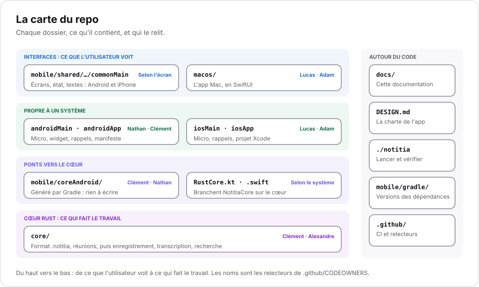
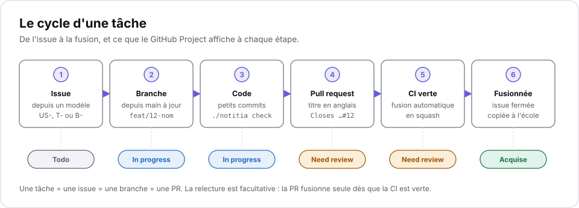

# Bien démarrer

Tu rejoins l'équipe : cette page te dit comment lancer l'app, où se trouve chaque chose et comment mener une tâche jusqu'à la fusion.

## Lancer l'app

Installe Android Studio et Rust, puis une seule commande à la racine du repo :

```bash
./notitia doctor   # ce qui manque sur ta machine, et comment l'installer
./notitia          # un menu : téléphone, émulateur, APK, Xcode, vérification
```

Le pas-à-pas complet, débogage USB compris, est dans [mobile/README.md](../mobile/README.md). Sur Mac, l'app Mac s'ouvre depuis [macos/README.md](../macos/README.md).

## Se repérer



Le code partagé du téléphone vit dans `mobile/shared/src/`, sous le paquet `com/example/notitia/`. Les chemins ci-dessous partent de là.

| Je veux… | Je vais dans… |
| --- | --- |
| Changer un écran | `commonMain/…/ui/` : un dossier par onglet (`meetings/`, `minutes/`, `actions/`, `search/`, `settings/`, `recording/`) |
| Changer une couleur, une taille, une police | `commonMain/…/ui/theme/` (`NotitiaTheme`), en suivant [DESIGN.md](../DESIGN.md) |
| Réutiliser un bouton, une carte, une ligne | `commonMain/…/ui/components/` |
| Changer un texte affiché | `commonMain/composeResources/values/strings.xml`, en français, jamais en dur |
| Toucher au micro, au widget, aux rappels | `androidMain/` pour Android, `iosMain/` et `mobile/iosApp/` pour l'iPhone |
| Toucher au format `.notitia` ou aux réunions | [`core/src/`](../core/src/), en Rust : la logique encore en Kotlin y part tâche par tâche (T-57 à T-61) |
| Appeler le cœur depuis l'app | `commonMain/…/bridge/NotitiaCore.kt`, tenu par `RustCore.kt` (Android) et `RustCore.swift` (iPhone) |
| Brancher un modèle d'IA | `commonMain/…/ai/` |
| Ajouter une dépendance | [`mobile/gradle/libs.versions.toml`](../mobile/gradle/libs.versions.toml), ou [`core/Cargo.toml`](../core/Cargo.toml) pour le cœur |
| Ajouter un test | `core/` (`cargo test`) pour le cœur, `commonTest/` pour le code partagé |
| Comprendre la CI | [`.github/workflows/`](../.github/workflows/) : `build.yml` pour l'app, `pr-rules.yml` pour le titre et la description des PR |
| Comprendre un choix technique | [L'architecture](README.md#larchitecture) et [les fiches de décision](adr/) |

## Mener une tâche



- **Les tâches** sont dans le [GitHub Project](https://github.com/orgs/NotitiaEIP/projects/10). Prends-en une au statut « Todo » du sprint en cours, ou crée l'issue depuis un modèle si elle n'existe pas.
- **La branche** se nomme `<type>/<numéro>-<description>`, par exemple `feat/12-record-lock-screen`. On ne travaille jamais sur `main`.
- **Le code, les commits et les noms** sont en anglais. Les textes de l'interface sont en français, dans les ressources.
- **Le titre de la PR** suit [Conventional Commits](https://www.conventionalcommits.org/fr/) : `feat(audio): keep recording when the screen is locked`. Sa description dit pourquoi, comment c'est testé, et finit par `Closes NotitiaEIP/Notitia#12`. La CI vérifie les deux.
- **Avant d'ouvrir la PR**, lance `./notitia check` : c'est la même vérification que la CI.

## Les cinq règles qui ne se discutent pas

| Règle | Ce que ça veut dire dans le code |
| --- | --- |
| Rien ne sort du téléphone | Aucun appel réseau ne transporte de l'audio, du texte ou des métadonnées de réunion. Aucun texte de réunion dans les journaux |
| Aucun secret dans le code | Pas de clé, de token ni de mot de passe dans le repo |
| Pas de sauvegarde cloud | Les réunions sont exclues des sauvegardes Android et iCloud |
| Ni empreinte vocale, ni émotion | Les locuteurs sont séparés réunion par réunion, jamais reconnus d'une réunion à l'autre |
| Audio compressé, gardé 30 jours | Jamais de WAV stocké. Le texte reste, l'audio part |

Le détail et le reste de ce qu'on fait cette année sont dans [le cadre](projet/cadre.md). Un doute sur une règle : on demande avant de coder.

## Qui demander

Chaque domaine a un responsable et un binôme, listés dans [la partie 9 du cadre](projet/cadre.md#9-qui-décide-quoi). GitHub demande leur relecture tout seul, d'après [`.github/CODEOWNERS`](../.github/CODEOWNERS).
