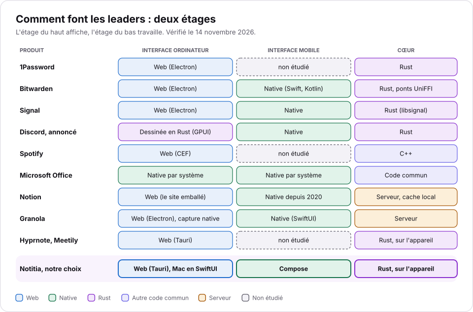
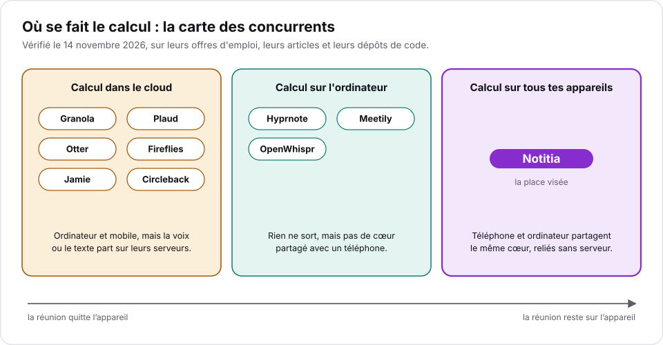

# Le benchmark

Les produits qui calculent sur l'appareil partagent tous un cœur écrit dans un langage natif, et affichent par-dessus une interface par famille d'appareils. C'est le modèle que Notitia reprend.

## La méthode

- **Ce qu'on a regardé.** Une dizaine de leaders du logiciel et neuf concurrents directs, le 14 novembre 2026.
- **Avec quoi.** Leurs dépôts de code quand ils sont publics, leurs articles techniques, et leurs offres d'emploi, qui disent souvent la technologie plus franchement que le site.
- **La question posée à chacun.** Avec quoi est faite l'interface sur ordinateur, sur mobile, et qu'est-ce qui est partagé entre les deux.

Tous les liens sont dans [la page des sources](sources.md).

## Les leaders : deux étages

Une app se découpe en deux étages. Celui du haut affiche, celui du bas travaille. Le tableau montre ce que chaque produit met à chaque étage.

| Produit | Ce qu'on en retient pour Notitia |
| --- | --- |
| [1Password](https://blog.1password.com/1password-8-the-story-so-far) | Un cœur Rust (chiffrement, base, recherche) a remplacé quatre apps écrites séparément |
| [Bitwarden](https://contributing.bitwarden.com/architecture/sdk/) | Le cas le plus proche du nôtre : cœur Rust, relié à Swift et à Kotlin par UniFFI. Une seule app ordinateur pour trois systèmes |
| [Signal](https://github.com/signalapp/libsignal) | La partie sensible vit dans une bibliothèque Rust commune à toutes les apps |
| [Discord](https://www.invenglobal.com/articles/28182/discord-cto-confirms-the-desktop-and-mobile-apps-are-being-rebuilt-in-rust) | Annonce du 4 novembre 2026 : tout le client réécrit en Rust, partagé entre ordinateur et mobile. Pas encore sorti, connu par la presse seulement |
| [Spotify](https://engineering.atspotify.com/2021/4/building-the-future-of-our-desktop-apps) | Une seule interface web pour tous les ordinateurs, posée sur un cœur C++ |
| [Microsoft Office](https://rcpmag.com/articles/2018/01/30/office-same-code-multiple-platforms.aspx) | Le seul à dessiner une interface native par système. Il en a les moyens |
| [Notion](https://www.notion.com/blog/notion-on-android-is-now-more-than-twice-as-fast-to-launch) | Son cœur est son serveur. Sur mobile, il est passé du site emballé au natif pour la vitesse |

## Les concurrents : où se fait le calcul

| Concurrent | Interface ordinateur | Mobile | Où se fait le calcul |
| --- | --- | --- | --- |
| [Granola](https://builtin.com/job/product-engineer-desktop/7193316) | Une app Electron pour Mac et Windows, avec capture native | iPhone en SwiftUI | Leurs serveurs |
| [Plaud](https://the-gadgeteer.com/2026/01/04/plaud-desktop-captures-your-virtual-meetings-without-the-bot-awkwardness/) | Mac et Windows depuis janvier 2026 | Oui, technologie non confirmée | Leurs serveurs |
| [Otter](https://builtin.com/job/software-engineer-otter-desktop/2489327) | Electron | Oui | Leurs serveurs, avec un bot |
| [Fireflies](https://jobs.khoslaventures.com/companies/fireflies-ai/jobs/64112384-mobile-engineer-react-native-platform) | Non étudiée | React Native | Leurs serveurs, avec un bot |
| [Jamie](https://www.meetjamie.ai/blog/llm-info) | Mac et Windows | iPhone | Des serveurs en Europe |
| [Circleback](https://circleback.ai/blog/how-we-rebuilt-our-electron-recording-engine-in-swift) | Electron, moteur d'enregistrement réécrit en Swift | Non étudié | Leurs serveurs |
| [Hyprnote](https://github.com/fastrepl/anarlog) | Tauri : cœur Rust et interface web. Sur Linux | Non étudié | Sur l'ordinateur |
| [Meetily](https://github.com/Zackriya-Solutions/meetily) | Tauri : cœur Rust et interface web. Sur Linux depuis les sources | Non étudié | Sur l'ordinateur |
| [OpenWhispr](https://openwhispr.com/blog/local-speaker-diarization) | Electron | Non étudié | Sur l'ordinateur |

## Trois leçons

1. **Qui calcule dans le cloud emballe son site web.** Notion, Granola ou Otter n'ont pas besoin d'un cœur partagé : leur serveur en tient lieu. Leur raison de choisir Electron ne s'applique pas à nous.
2. **Qui calcule sur l'appareil partage un cœur natif.** C'était du C++ hier (Spotify, Office), c'est du Rust aujourd'hui (1Password, Bitwarden, Signal, bientôt Discord).
3. **Sur ordinateur, presque personne ne dessine une interface par système.** Tous livrent une seule interface pour Windows, Mac et Linux. Microsoft est l'exception.

À notre connaissance, aucun concurrent n'a aujourd'hui un cœur sur l'appareil partagé entre le téléphone et l'ordinateur. C'est la place que Notitia vise.

## Les limites de ce benchmark

On préfère les écrire plutôt que les cacher.

- Les offres d'emploi disent ce qu'une équipe utilise, pas comment. Le détail de Granola et de Plaud reste une déduction.
- L'annonce de Discord n'est connue que par la presse. Le produit n'est pas sorti.
- Les cases « non étudié » sont des trous assumés, pas des « non ».
- Aucune mesure de vitesse ou de mémoire n'a été faite par nous. Les ordres de grandeur viennent de ce que chaque technologie embarque. Le prototype de l'ordinateur les mesurera.
