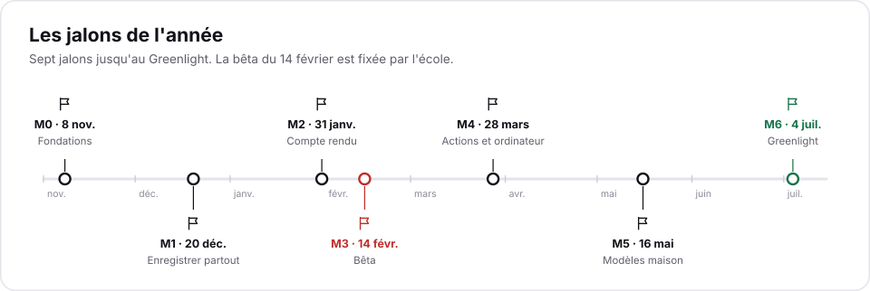

# Cadre Notitia 2026-2027

Version 1 du 24 octobre 2026, proposée par Clément, validée par l'équipe dans la PR qui ajoute ce fichier.

Ce cadre fixe ce qui ne change pas d'ici le Greenlight de juillet 2027. Le travail de chaque semaine vit dans le [GitHub Project](https://github.com/orgs/NotitiaEIP/projects/10), et chaque choix technique dans une fiche de décision (ADR). Si une tâche contredit ce cadre, c'est la tâche qu'on corrige, ou alors on change le cadre selon la règle de la partie 9.

## 1. Notitia en une phrase

Notitia enregistre tes réunions, en présentiel avec ton téléphone et en visio avec ton ordinateur, puis en tire sur l'appareil un compte rendu avec les décisions et une action par ligne, sans que rien ne sorte de chez toi.

## 2. Pour qui

- **Ceux qui l'utilisent :** les cadres et les équipes dont les réunions sont confidentielles, dans la santé, l'éducation et l'industrie. Dans nos entretiens : Laure au CHU, Darius et Eric à Epitech, les concepteurs de puces du formulaire.
- **Celui qui paie :** l'organisation, par ses admins système, pas l'utilisateur.
- **C'est une hypothèse :** la bêta la confirme ou la corrige (B-05), et on ne la change qu'au bilan de la bêta (B-07, fin mars).

## 3. Ce que Notitia promet

1. Enregistrer partout : le téléphone en présentiel, l'ordinateur en visio, sans bot.
2. Transcrire et écrire le CR sur l'appareil, en français, même en mode avion.
3. Savoir qui a dit quoi, chaque point du CR relié à sa phrase.
4. Partager sans exposer : directement entre appareils Notitia, ou verrouillé par un code, avec les noms masqués si besoin.
5. Suivre les actions d'une réunion à l'autre, et retrouver une info dans toutes les réunions.

## 4. Les règles qui ne bougent pas

Ce sont les cinq règles produit de l'[AGENTS.md](https://github.com/NotitiaEIP/Notitia/blob/main/AGENTS.md) de Notitia. Les précisions en italique viennent des choix du 24 octobre.

1. **Rien ne sort de l'appareil.** *Relier ses propres appareils est permis : chiffré de bout en bout, sans compte ni serveur. Un envoi est toujours un geste de l'utilisateur, et Notitia lui propose d'abord la version protégée. Aucun texte de réunion dans les journaux de l'app.*
2. **Aucun secret dans le code.** *Clés de signature et certificats dans les secrets GitHub, accessibles à deux personnes.*
3. **Pas de sauvegarde cloud.** *Ce qui protège de la perte du téléphone, c'est un ordinateur relié ou un export.*
4. **Ni empreinte vocale, ni analyse d'émotion.**
5. **Audio compressé, gardé 30 jours par défaut.** *La transcription et le CR restent, chiffrés eux aussi.*

## 5. Ce qu'on ne fait pas cette année

| On ne fait pas | Pourquoi |
| --- | --- |
| Un bot qui rejoint les visios | Il casse la règle 1 et demande un serveur allumé en permanence. Ceux qui ont le plus besoin de Notitia le refusent |
| La transcription ou le CR dans le cloud | C'est toute la différence avec Granola, Teams et Copilot |
| Des comptes sur nos serveurs | Ton identité, ce sont tes appareils reliés ; en entreprise, l'annuaire de l'entreprise |
| Un relais sur notre serveur | Seulement si la bêta en montre le besoin, et par une PR dédiée |
| Deux appareils qui enregistrent la même réunion | Une réunion, un appareil qui enregistre |
| Rejoindre une visio depuis le téléphone | Le téléphone ne peut pas enregistrer un appel Teams. Hypothèse P2 après la bêta |
| L'anglais et l'international | Français seulement jusqu'au Greenlight. Les textes sont déjà dans les ressources |
| Le partage par étiquette NFC du MVP | Une étiquette courante tient moins d'1 Ko, trop peu pour un CR |
| L'éditeur de notes du Mac | Les entretiens demandent un CR, pas un carnet de notes |
| Changer de sujet | Sujet validé par l'école le 13 octobre |

## 6. Les choix d'architecture

- Kotlin Multiplatform et Compose pour Android. L'iPhone et l'ordinateur suivent les fiches T-04 et T-05.
- Un seul format de réunion pour tous les appareils : versionné, avec un identifiant unique par réunion (T-07).
- L'IA tourne sur l'appareil. En attendant nos modèles, la bêta peut s'appuyer sur Apple Intelligence et Gemini Nano là où ils existent, et sur un modèle ouvert ailleurs, tous derrière la même interface (T-06). Les modèles sont livrés par les stores, jamais dans le repo. Chacun a son numéro de version, et ne sort que s'il bat le précédent sur le jeu d'évaluation (T-91).
- L'ordinateur capte le son de la visio et le micro en local.
- Les appareils d'une personne se relient par QR code, sans compte : par fichier pour la bêta, puis automatiquement sur le même réseau en M4.
- Un choix technique s'écrit une fois dans une fiche ADR. On ne le rediscute que par une nouvelle fiche qui remplace l'ancienne, comme une loi qui en abroge une autre.

## 7. Le modèle économique visé

Comme Bitwarden : un gratuit, des forfaits pour la personne, une licence pour l'organisation. Les noms et les chiffres sont provisoires : B-03 les précise en M2, et la bêta les teste.

| Offre | Ce qu'elle contient |
| --- | --- |
| Nota, gratuit | 10 h d'enregistrement par mois, un format de compte rendu, toutes les protections, l'envoi d'un fichier à son ordinateur |
| Volumen | 40 h par mois, plusieurs formats de compte rendu, la synchro automatique entre ses appareils reliés |
| Bibliotheca | Les heures illimitées, et tout ce que contient Volumen |
| Collegium, licence organisation | Déployée par les admins système avec leur outil de gestion des appareils (Intune…), avec leurs règles : conservation, exports permis, réunions confidentielles par défaut |
| Option auto-hébergée | Un serveur Notitia en Docker chez l'organisation, pour le relais entre appareils et le partage par lien à usage unique. Rien n'arrive chez nous, et un CHU l'installe sur son infra déjà agréée pour la santé |

Ce qui tient, même si les noms et les chiffres changent :

- Une heure ne nous coûte rien, puisque c'est l'appareil qui calcule. Un forfait se paie pour ce qu'il apporte en plus, pas pour couvrir un coût.
- Le quota ne coupe jamais une réunion en cours : c'est la suivante qui attend.
- Ce qui protège reste gratuit : PDF verrouillé, noms masqués, export complet, effacement.
- Un abonnement vaut pour tous les appareils reliés, payé sur le Play Store, l'App Store ou le Microsoft Store. Toujours sans compte chez nous : le reçu signé par le store passe d'un appareil à l'autre à l'appairage.
- Si l'abonnement s'arrête, on repasse en Nota : rien n'est effacé, tout reste lisible et exportable.

Pendant la bêta, tout le monde est en Bibliotheca et personne ne paie. On ne construit les forfaits et la licence qu'après la bêta (E11), si elle confirme qu'on paierait. Encaisser de l'argent demandera une structure juridique : on n'en parle que si un client veut payer avant juillet.

## 8. Les jalons

| Jalon | Fin | On montre |
| --- | --- | --- |
| M0 Fondations | 8 novembre | CI, package renommé, sauvegardes coupées, format commun et trois choix techniques écrits |
| M1 Enregistrer partout | 6 décembre | Une réunion d'une heure enregistrée écran verrouillé sur Android et iPhone, en mode avion, puis transcrite |
| M2 Compte rendu | 31 janvier | Le CR juste après la réunion, envoyé en clair ou verrouillé |
| M3 Bêta | 14 février | L'app chez au moins 12 testeurs, le Beta Test Plan rendu |
| M4 Actions et ordinateur | 28 mars | Les actions suivies, une visio enregistrée sans bot, le téléphone relié à l'ordinateur, le bilan de la bêta |
| M5 Modèles maison | 16 mai | Nos modèles mesurés sur le jeu d'évaluation et livrés sur le téléphone |
| M6 Greenlight | 4 juillet | La version publique en français et la soutenance |

## 9. Qui décide quoi

- Chaque domaine a un responsable et un binôme. Le responsable prend les issues du domaine par défaut et tranche, après avoir écouté son binôme, qui suit ses PR et le remplace s'il est absent. La relecture d'une PR est facultative : GitHub prévient le binôme, mais la PR se fusionne dès que la CI est verte.

  | Binôme | Qui | Domaine | Epics |
  | --- | --- | --- | --- |
  | Android | Nathan | Enregistrement, arrière-plan, widget, stockage, appareils reliés | E1, E8, E10 |
  | Android | Clément | Suivi des actions, organisation, CI, pilotage du business | E1, E5, Socle, Business |
  | iOS et compte rendu | Lucas | Enregistrement iOS, transcription et locuteurs | E1, E2 |
  | iOS et compte rendu | Adam | Compte rendu et envoi, en code partagé | E3, E4 |
  | IA et ordinateur | Alexandre | Modèles maison, jeu d'évaluation, recherche | E6, E9 |
  | IA et ordinateur | Amine | Client ordinateur, visios, organisations | E7, E11 |

- Un choix qui touche plusieurs domaines s'écrit dans une fiche ADR, relue par les responsables concernés.
- Ce cadre ne change qu'à la revue de fin de jalon, par une PR que toute l'équipe relit. En cas de désaccord, Clément tranche et prévient le mentor.
- Ce qui n'est pas dans le Project n'existe pas : une idée devient une issue, même en P2.

## 10. Les risques qu'on surveille

| Risque | Ce qu'on fait |
| --- | --- |
| L'IA est trop lente ou trop mauvaise en français sur un téléphone moyen | T-06 mesure avant de coder, avec un plan B écrit |
| iOS coupe l'enregistrement en arrière-plan | US-12 testé dès M1 sur un vrai iPhone |
| Apple, Google ou Microsoft ajoutent la transcription locale | Notre valeur est autour : CR avec actions, partage protégé, plusieurs appareils, gestion par l'organisation |
| 12 témoignages sur 18 viennent d'une seule entreprise | B-02, puis la bêta |
| Une seule personne connaît un domaine | Binômes : le binôme est prévenu de chaque PR du domaine (CODEOWNERS) et peut le reprendre |
| Un store refuse une app qui enregistre | TestFlight et test fermé Play dès M3, annonce de consentement toujours visible |
| Le nom Notitia est déjà déposé | Vérification INPI et EUIPO en M2 (B-10) |

## 11. Questions ouvertes

| Question | Qui | Pour quand |
| --- | --- | --- |
| Comment coder l'app iOS | Lucas, Adam (T-04) | 8 novembre |
| Quelle techno pour l'ordinateur | Amine, Alexandre (T-05) | 8 novembre |
| Quel moteur IA pour la bêta, et quels téléphones minimum | Alexandre (T-06) | 8 novembre |
| Quels objectifs de track | Toute l'équipe (B-01) | Rendez-vous mentor |
| Qui a un Mac, un iPhone, un Android milieu de gamme | Toute l'équipe | Début du sprint 1 |
| Le compte Google Play de l'école est-il personnel ou d'organisation (probablement d'organisation) | Clément, avec l'école | Avant M3 |
| Quelle licence pour le code | Toute l'équipe (B-03) | M2 |
| La cible est-elle la bonne | Toute l'équipe (B-07) | Fin mars |
