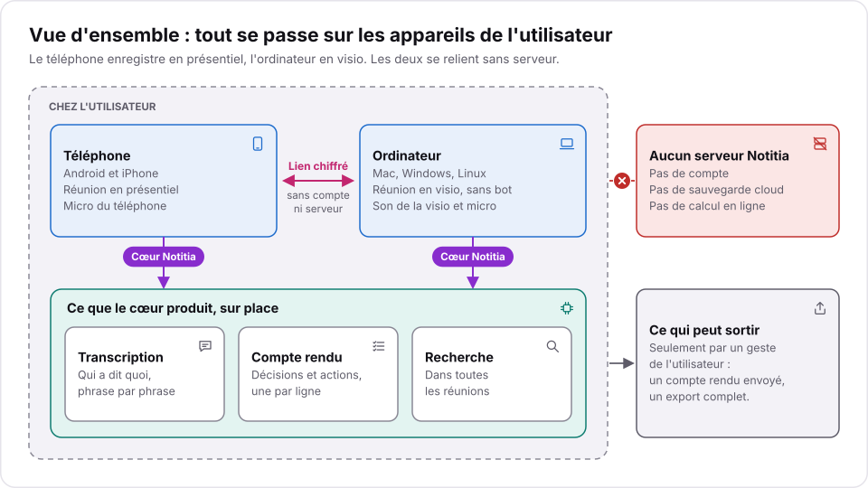
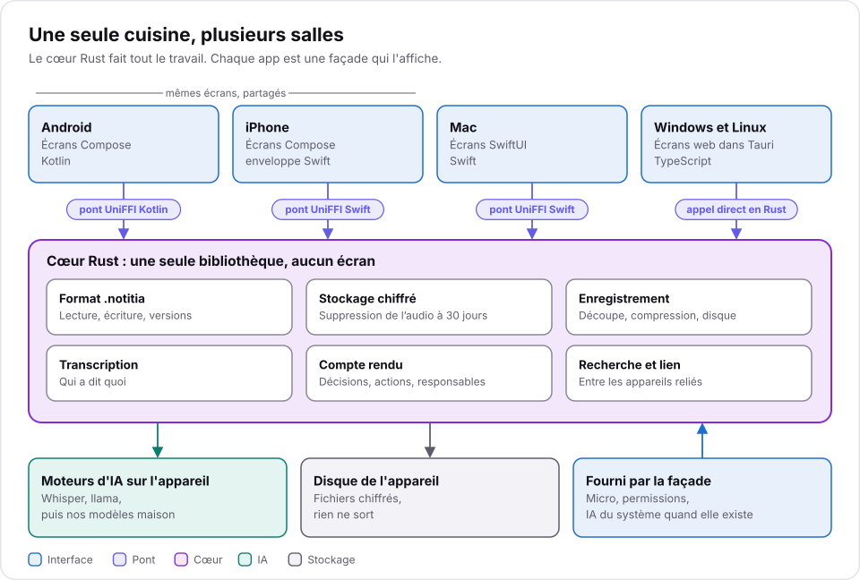

# Vue d'ensemble

Notitia tourne entièrement sur les appareils de l'utilisateur : le téléphone enregistre les réunions en présentiel, l'ordinateur les visios, et les deux se relient sans passer par un serveur.



## Trois règles dessinent toute l'architecture

Ces règles viennent du [cadre](cadre.md) du projet. Chacune ferme des portes techniques, et c'est voulu.

| La règle | Ce qu'elle impose à la technique |
| --- | --- |
| Rien ne sort de l'appareil | La transcription et le compte rendu sont calculés sur place. Pas de serveur, pas de compte, pas de sauvegarde cloud |
| Enregistrer partout | Cinq systèmes à couvrir : Android, iPhone, Mac, Windows, Linux |
| Relier ses appareils sans serveur | Le même format de réunion et le même code des deux côtés, sinon ils ne se comprennent pas |

La troisième règle est celle qui pèse le plus. Un concurrent qui calcule dans le cloud n'a pas ce problème : son serveur est le point commun entre ses apps. Nous n'avons pas de serveur, donc le point commun doit être dans chaque app.

## La réponse : un cœur, plusieurs façades

C'est comme un restaurant avec une seule cuisine et plusieurs salles. La cuisine prépare tous les plats de la même façon. Chaque salle a sa propre décoration, adaptée à son quartier.



| Étage | Technologie | Pourquoi, en une ligne | Détail |
| --- | --- | --- | --- |
| Cœur | Rust | Un seul code pour les cinq systèmes, léger, qui parle directement aux moteurs d'IA | [Le cœur](../architecture/coeur-rust.md) |
| Écrans Android et iPhone | Kotlin, Compose | Les écrans existent déjà et portent la charte | [Le téléphone](../architecture/android-iphone.md) |
| Écrans Mac | Swift, SwiftUI | L'app existe, et le Mac a un responsable | [Le Mac](../architecture/mac.md) |
| Écrans Windows et Linux | Web, dans Tauri | Une interface pour deux systèmes, posée directement sur le cœur | [Windows et Linux](../architecture/windows-linux.md) |
| Ponts | UniFFI | Traduit le cœur pour Kotlin et pour Swift, sans code écrit à la main | [Le cœur](../architecture/coeur-rust.md) |

## Où vit le code

Tout est dans un seul repo. Les dossiers `core/` et `desktop/` arrivent avec le chantier.

```text
Notitia/
├── core/      le cœur Rust (à venir)
├── mobile/    les écrans Android et iPhone, en Kotlin
├── macos/     l'app Mac, en Swift
├── desktop/   l'app Windows et Linux, dans Tauri (à venir)
└── docs/      ce dossier
```

## La vision à long terme

L'architecture est pensée pour que chaque étape s'ajoute sans refaire la précédente.

| Quand | Ce qui s'ajoute | Ce que l'architecture apporte |
| --- | --- | --- |
| Bêta, 14 février | Le téléphone enregistre, transcrit et écrit le compte rendu | Le cœur est validé sur deux systèmes |
| Jalon M4, 28 mars | L'ordinateur capte les visios, le téléphone s'y relie | L'ordinateur réutilise tout le cœur, il ne reste que l'interface et la capture |
| Jalon M5, 16 mai | Nos propres modèles d'IA | Un moteur se remplace derrière son interface, sans toucher aux écrans |
| Ensuite | Les organisations, un serveur optionnel installé chez elles | Le cœur tourne aussi sans écran, donc aussi sur un serveur |
