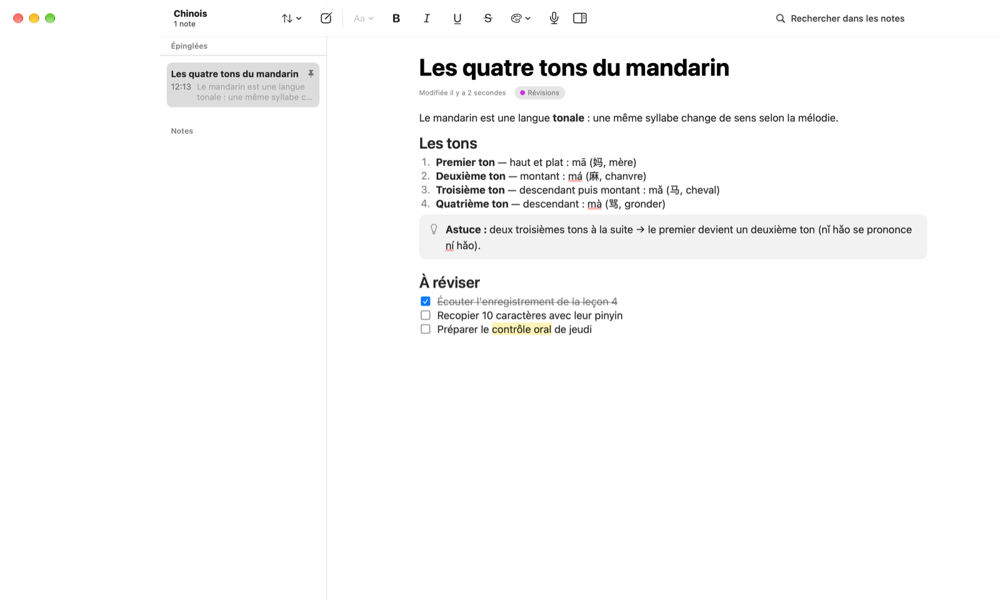

# Notitia pour Mac

L'app Mac de Notitia, en Swift/SwiftUI. Le projet et ses autres dossiers sont présentés dans le
[README de la racine](../README.md).


## Fonctionnalités

- **Prise en main** : tutoriel en 7 pages au premier lancement, puis une note **« Aide »** épinglée qui montre
  chaque type de bloc, chaque style et tous les raccourcis. Les deux restent accessibles depuis le menu
  Aide (`⌘?` et « Revoir le tutoriel »).
- **Enregistrement et transcription** : capture micro, **reconnaissance vocale réelle sur l'appareil**
  (Apple SpeechAnalyzer), audio **chiffré**, lecture synchronisée (cliquer un horodatage), rappel du consentement
  des participants.
- **Qui parle** : à l'arrêt, chaque phrase est attribuée à « Locuteur 1, 2… » (voix distinguées sur l'appareil, sans
  modèle ni identification), que l'on peut renommer ; nombre de participants facultatif dans le rappel de consentement.
- **Transcription enrichie et fidèle** : rires, applaudissements, longs silences et volume élevé repérés sur
  l'appareil (SoundAnalysis), ton des passages déduit du texte (Foundation Models), « Citer avec le contexte »,
  transcription d'origine en lecture seule avec empreinte. **Aucune déduction d'émotion** : les annotations décrivent
  un moment, jamais une personne (voir [docs/PRIVACY.md](docs/PRIVACY.md) §6).
- **Intelligence locale** : résumé (points clés, décisions, actions, questions), mots-clés, carte mentale
  interactive reliée à la transcription, et « réécrire avec mes mots-clés ». Avec Apple Intelligence, tout est
  **reformulé** sur le Mac, et chaque point renvoie à la phrase prononcée (les points sans source vérifiable sont
  écartés).
- **Confidentialité** : 100 % hors ligne, aucune connexion réseau autorisée, export complet, effacement total.
  Voir [docs/PRIVACY.md](docs/PRIVACY.md).

Les notes viennent de la première version. Elles restent dans l'app, mais on ne leur ajoute plus de
fonctionnalités : les entretiens demandent un compte rendu, pas un carnet de notes.

- **Organisation** : dossiers et sous-dossiers illimités (Cours › Chinois, Anglais, Maths…), icônes et couleurs,
  glisser-déposer des notes et des dossiers, épinglage, tags, corbeille (30 jours), recherche plein texte
  insensible aux accents, ouverture rapide (⌘K).
- **Éditeur par blocs** : texte, titres, listes à puces / numérotées / de tâches, citations, encadrés, code,
  séparateurs, images. Menu `/`, raccourcis Markdown (`# `, `- `, `[] `, `> `, ` ``` `, `---`),
  gras / italique / souligné / barré / code / couleur / surlignage / lien, indentation (Tab), réorganisation
  par glisser-déposer. ⌘Z annule aussi les opérations sur les blocs ; sélection de plusieurs blocs (Échap, ⇧↑/⇧↓,
  ⌘A) ; coller plusieurs lignes crée un bloc par ligne (Markdown reconnu).



> La transcription utilise le modèle de langue fourni par macOS : installez-le une fois dans
> Réglages › Transcription. Le moteur de **démonstration** (texte d'exemple) reste disponible pour essayer
> l'application sans parler. Sans Apple Intelligence (Mac non compatible ou fonction désactivée), le résumé et la
> carte mentale utilisent le moteur extractif local, qui sélectionne les phrases telles quelles.

## Prérequis

- macOS 26 (Tahoe) ou plus récent
- Xcode 26.3 ou plus récent (Swift 6.2)

Aucune dépendance externe, aucun gestionnaire de paquets, aucune clé d'API. Les commandes ci-dessous se lancent
depuis la racine du repo.

## Lancer le projet

```bash
open macos/apple/Notitia.xcodeproj      # puis ⌘R dans Xcode
```

En ligne de commande :

```bash
cd macos/apple
xcodebuild -project Notitia.xcodeproj -scheme Notitia -destination 'platform=macOS' build
```

Options de lancement utiles (Xcode › Product › Scheme › Edit Scheme › Arguments) :

| Argument | Effet |
|---|---|
| `-NotitiaDemoMode YES` | Base **en mémoire** pré-remplie avec des exemples (ne touche pas à vos données). |
| `-NotitiaSnapshots YES` | (Debug, avec le mode démo) parcourt quelques écrans et enregistre des captures PNG dans `~/Library/Containers/com.notitia.Notitia/Data/tmp/`. |
| `-NotitiaSnapshotTutorial YES` | (Debug, avec les deux options ci-dessus) démarre sur le tutoriel et en exporte chaque page, en clair et en sombre. |

## Tests

La logique métier vit dans le package `NotitiaKit` et se teste sans interface :

```bash
cd macos/apple/NotitiaKit
swift test
```

Les tests couvrent : note d'aide, texte riche (dont Unicode/UTF-16), opérations de l'éditeur (dont annulation,
collage et sélection de plusieurs blocs), raccourcis Markdown,
format de document, recherche, IA locale, moteur de démonstration, disposition des cartes mentales,
chiffrement de l'audio, conservation des données, export et effacement RGPD, annotations (sons, volume, ton),
chronologie et citations, empreinte de la transcription, suivi et découpage en phrases des résultats de
SpeechAnalyzer, séparation des locuteurs (voix synthétiques), découpage et vérification des sources des résumés
reformulés.

Quatre tests d'**intégration** utilisent les vrais moteurs d'Apple (parole de synthèse produite par `say`, voix
française « Thomas », modèle de langue français, Apple Intelligence). Ils sont désactivés par défaut :

```bash
cd macos/apple/NotitiaKit
NOTITIA_INTEGRATION=1 swift test --filter AppleEnginesIntegrationTests
```

La séparation des locuteurs se teste sur les trois voix de la réunion de test, générées d'abord par le script
(lancé depuis `swift test`, `say` remplace la plupart des voix par la voix par défaut) :

```bash
macos/scripts/reunion-test/generer.sh
cd macos/apple/NotitiaKit
NOTITIA_INTEGRATION=1 swift test --filter SpeakerDiarizationIntegrationTests
```

## Structure

```
macos/
├── apple/
│   ├── Notitia.xcodeproj   ← projet Xcode (dossiers synchronisés : tout fichier ajouté dans Notitia/ est compilé)
│   ├── Config/             ← entitlements (sandbox, micro, PAS de réseau)
│   ├── Notitia/            ← application macOS (SwiftUI + AppKit pour l'éditeur)
│   │   ├── App/            ← démarrage, fenêtre, menus, préférences
│   │   ├── DesignSystem/   ← jetons et composants visuels
│   │   ├── Features/       ← Sidebar, NoteList, Editor, Inspector, Recording, MindMap, Settings, Welcome
│   │   └── Resources/      ← icône, textes localisables, manifeste de confidentialité
│   └── NotitiaKit/         ← package Swift : modèles, éditeur, IA, audio, confidentialité, export
│       ├── Sources/NotitiaKit/   ← Models, Editor, AI, Audio, Privacy, Storage, Export, Search
│       └── Tests/NotitiaKitTests/
├── docs/
│   ├── ARCHITECTURE.md     ← couches, « où est quoi » par fonctionnalité, format de données portable
│   ├── DESIGN.md           ← identité visuelle
│   ├── PRIVACY.md          ← RGPD : registre des traitements, mesures, droits
│   ├── ROADMAP.md          ← l'ancienne feuille de route (la suite se suit dans le GitHub Project)
│   └── screenshots/        ← captures générées (mode démo)
└── scripts/reunion-test/   ← réunion de test à trois voix de synthèse
```

## Contribuer

Pour l'app Mac :

1. `swift test` doit passer et l'application doit compiler sans avertissement.
2. Toute logique non visuelle va dans `NotitiaKit`, avec ses tests.
3. **Jamais de clé d'API ni de secret dans le code.** Voir [docs/PRIVACY.md](docs/PRIVACY.md).
